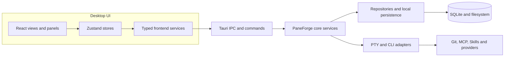
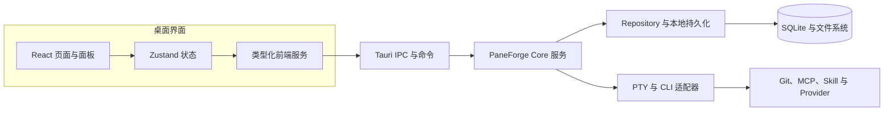

# PaneForge

PaneForge is a local-first desktop engineering workbench for developers who run AI coding CLIs in parallel. It brings projects, terminals, agent workflows, Git, files, and review evidence together without hiding work inside an opaque automation service. PaneForge is built on a modified GPL-3.0 CC-Panes desktop-workspace foundation and adds its own product identity, Blueprint planning, and control-plane layer.

This repository is the public distribution and engineering showcase for PaneForge. It contains release artifacts, reproducible source references, selected browseable source from the released version, release verification workflows, and product documentation. The complete development repository and its Git history remain private.


*Animated sequence of two screenshots captured by the Windows native acceptance run: the created task tree, then the app after restart. This is not a continuous screen recording.*

Frame 1 shows the saved root and child, with the child description and acceptance criterion. Frame 2 is a separate post-restart snapshot: both tasks remain, the parent link is intact, and the child remains selected. Creation persists a `planned` task; it does not dispatch a CLI or certify completion.

[Open the first screenshot](docs/media/blueprint-alpha3-created.png) · [Open the post-restart screenshot](docs/media/blueprint-alpha3-reopened.png) · [Native acceptance run](https://github.com/lihuabin1516-design/PaneForge-Releases/actions/runs/40461026994)

## What PaneForge provides

| Area | Public preview status | What it does |
| --- | --- | --- |
| Workspaces and projects | Preview | Provides a workspace command center for active sessions, recent projects, available CLIs, and usage context; organizes repositories, settings, layouts, and project order. |
| Terminal workspace | Preview | Runs real PTY-backed CLI sessions in resizable split panes and tabs, with saved layouts, scrollback, and recovery support. |
| CLI integrations | Preview; requires local CLI setup | Includes launch adapters for Claude Code, Codex CLI, Gemini CLI, Kimi, Grok, OpenCode, and Cursor; the adapter registry also contains Pi, OMP, and JCode integrations. Other terminal commands can run in a PTY; feature depth varies by CLI. |
| Local and remote runtimes | Preview; environment-dependent | Supports local, WSL, and SSH project routes where configured, so a terminal can work against the selected project environment. |
| Agent workflow tools | Preview | Brings Agent Chat, bounded MCP leader/worker orchestration, Plans, Specs, Todos, Journals, session summaries, and Memory alongside terminal sessions. |
| Launch profiles and shared tooling | Preview | Reuses provider/model, runtime, permission, hook, Skill, and MCP choices; supports project and shared MCP/Skill configuration where applicable. |
| Git and worktrees | Preview | Provides repository status and common pull/push/fetch/stash operations, branches, clone, worktrees, commit topology, diffs, and conflict resolution. |
| Files and editing | Preview | Browse, search, create, rename, copy, move, and delete project files; edit with Monaco and preview Markdown/images. |
| Session continuity | Preview | Keeps launch history and session identity available to inspect, resume supported sessions, and clean up broken-session records. Resume behavior depends on the CLI. |
| Local history and screenshots | Preview | Offers labeled local file-history snapshots and diff review, plus multi-monitor screenshot capture with a configurable shortcut. |
| Desktop controls and appearance | Preview | Includes command palette, tray and quick-terminal controls, resource monitoring, themes, wallpaper, and terminal/background appearance settings. |
| Blueprint planning | Preview | Creates and persists parent and child tasks with descriptions and acceptance criteria; creating a task does not dispatch a CLI. |
| PaneForge Control Plane | Preview | Displays task-tree, intervention/recovery, delegation, and plugin-governance records; records are not proof of process execution. |
| Plugin capability policy | Preview | Uses revision-bound approvals and a default-deny broker; the alpha.3 release does not expose arbitrary plugin host side effects. |
| Updates and source traceability | Preview | Publishes Windows x64 preview packages with updater signatures, hashes, matching GPL source archives, and automated verification. |
| Blueprint execution and delivery workflow | Development | Run profiles, frozen team templates, human handoff cards, and consolidated delivery evidence are not included in the current public installer. |

The status labels are deliberate. CLI-specific features such as hooks, session restoration, and MCP behavior are not identical across integrations. A capability marked `Development` must not be inferred from the current public installer. PaneForge began from the CC-Panes `0.12.20` foundation and selectively adopted changes from `0.12.21`; it is not a claim of complete upstream feature parity. See [upstream provenance](docs/compliance/upstream-provenance.md) and [public scope](docs/engineering/public-scope.md) for the exact boundary.

## Control Plane visual tour

These are three separate, read-only Control Plane views captured during isolated Windows acceptance on 2026-09-19. The records are synthetic `[TEST FIXTURE]` data. The companion P1.2c UI acceptance snapshot records the tested app as `PaneForge DEV v0.0.1`; all three PNGs are panel crops without app chrome or a version label. None is a screenshot of the current `0.0.3-alpha.3` installer. The current-release evidence is the Blueprint persistence sequence above.

### Task tree and runtime identity

The upper half shows a parent in progress and its indented child marked complete. The selected child's detail pane names its node (`smoke-child`), parent (`smoke-root`), session (`smoke-session`) and attempt (`smoke-attempt-child`) separately. It also shows business state, runtime health, revision and update time. This is useful when checking that a task projection has preserved hierarchy and identity instead of treating a title or terminal transcript as the whole task record.

<a href="docs/media/control-plane-task-tree-dev.png"></a>

The rows and IDs are test fixtures. The image demonstrates how the UI displays stored task and runtime fields; it does not show a live CLI process, prove that an Agent completed the task, or show the current alpha.3 installer. See [task-tree and runtime identity notes](docs/product-capabilities.md#task-tree-and-runtime-identity) and [open the image at full size](docs/media/control-plane-task-tree-dev.png).

### Intervention and recovery history

This view intentionally separates two scopes. The intervention ledger is for node `p12b-node` and contains a pause request plus a message request from the current and an earlier attempt. The recovery ledger is for session `p12b-session`: it shows a disconnected-to-ready recovery for the selected node and a degraded-to-ready record for another node in the same session. Actor, reason, timestamp, node and attempt labels let a reviewer see which event belongs to which scope and attempt.

<a href="docs/media/control-plane-history-dev.png"></a>

These are synthetic ledger rows, not conversation messages and not evidence that an intervention or recovery action was actually performed. The screen is read-only. See [intervention and recovery history notes](docs/product-capabilities.md#intervention-and-recovery-history) and [open the image at full size](docs/media/control-plane-history-dev.png).

### Global delegation and plugin records

The left section labels delegation reviews as global and pairs decisions with their review reasons: a bounded tests-and-docs request is approved, while a production-deployment request is rejected. The right section labels the plugin registry as global and distinguishes an enabled build inspector from a registered network reporter. The notice above both ledgers explicitly says that review and registration records do not mean an Agent or plugin executed.

<a href="docs/media/control-plane-governance-dev.png"></a>

All names, actors, grants and decisions are test fixtures. This is a read-only projection: the image does not demonstrate a delegated run, plugin launch, plugin side effect, or host sandbox. See [global governance record notes](docs/product-capabilities.md#global-governance-records) and [open the image at full size](docs/media/control-plane-governance-dev.png).

See the [control-plane feature notes](docs/product-capabilities.md#agent-control-plane-records), [acceptance case](docs/engineering/portfolio-evidence.md#case-study-c-scoped-control-plane-projections) and [image provenance](docs/media/README.md) for precise scope, date, source identity and hashes.

## How the system is organized



This derived component map answers where a user action goes; it is not a replacement for the source contracts. The fuller [architecture and lifecycle diagrams](docs/architecture/product-map.md) identify each boundary and the alpha.3 planning/dispatch split.

## Engineering highlights

| Engineering problem | PaneForge approach | Browseable proof |
| --- | --- | --- |
| A planned task must survive retries and restarts | UUID-idempotent creation in an immediate SQLite transaction; a child checks the selected parent's revision and state. | [Task-tree model, repository and tests](showcase/README.md) |
| Agent output is not proof of task completion | Blueprint plans remain `planned` and unassigned; task planning does not start a CLI or certify acceptance. | [Lifecycle diagram](docs/architecture/product-map.md) |
| Plugin permissions must not be ambient | Revision-bound manifest/grant checks plus explicit per-resource allowlists; the alpha.3 broker is default-deny and exposes no plugin side effect. | [Capability broker source sample](showcase/source/v0.0.3-alpha.3/paneforge-core/src/services/plugin_host_adapter.rs) |
| A release must be attributable to exact source | Source commit, ZIP hash, toolchain/lockfiles, installer hash and isolated Windows smoke are recorded independently. | [Release evidence](docs/engineering/portfolio-evidence.md) |

## Browse the code

The [source showcase](showcase/README.md) contains selected unmodified files from the already-published alpha.3 source revision, including implementation and tests. It is a code-navigation aid, not a standalone build tree. The complete corresponding GPL source archive remains attached to the [versioned release](https://github.com/lihuabin1516-design/PaneForge-Releases/releases/tag/v0.0.3-alpha.3).

## Current download

The current public channel is the Windows x64 preview channel:

- [Latest PaneForge release](https://github.com/lihuabin1516-design/PaneForge-Releases/releases)
- [Windows x64 preview installer](https://github.com/lihuabin1516-design/PaneForge-Releases/releases/tag/v0.0.3-alpha.3)
- [Chinese documentation](README.zh-CN.md)

Install the preview package once. Later preview releases can be discovered from **Settings -> About -> Check for updates**. Save active sessions before installing an update; the installer may restart the desktop process.

PaneForge keeps release data under `%USERPROFILE%\.paneforge`. Development builds use `%USERPROFILE%\.paneforge-dev`, so a development build does not silently take over an installed release. The release channel currently targets Windows x64; native verification is performed on Windows runners.

## Architecture at a glance

```text
React UI
  -> Zustand stores and service wrappers
  -> Tauri IPC
  -> Rust commands
  -> domain services and repositories
  -> SQLite, filesystem, PTY, Git, and optional remote adapters
```

The important design boundary is that a CLI session is an observed runtime, not the database itself. PaneForge records launch intent, session identity, task binding, output evidence, and recovery state separately. This lets the UI restore a workspace without pretending that an interrupted process completed its task.

More detail:

- [Product capabilities and workflow](docs/product-capabilities.md)
- [Architecture, authority boundaries and Mermaid flows](docs/architecture/product-map.md)
- [Implementation and acceptance evidence](docs/engineering/portfolio-evidence.md)
- [System overview](docs/architecture/system-overview.md)
- [Control-plane lifecycle](docs/architecture/control-plane.md)
- [Runtime and capability boundaries](docs/architecture/runtime-boundaries.md)
- [Verification and evidence](docs/engineering/verification.md)

## Public and private repositories

PaneForge uses two repository roles:

1. The private product repository contains the complete source tree, development history, unreleased work, internal workflow files, and private acceptance material.
2. This public distribution repository contains only material intended for users and reviewers: release assets, corresponding-source references, public verification workflows, and product documentation.

No user workspace, provider secret, session transcript, private task ledger, signing key, or internal Git history belongs in this repository. The public scope is reviewed before each release.

## Build and verification

The release workflow can fetch the exact source archive attached to a release and verify its commit, SHA-256, lockfiles, product identity, frontend checks, Rust checks, package build, and isolated Windows smoke evidence. It is intentionally separate from the local development tree.

See [the release process](docs/engineering/release-process.md) and [the verification contract](docs/engineering/verification.md). A public source archive is named `PaneForge_<version>_source.zip` and is paired with `SHA256SUMS.txt` in the corresponding release.

## Legal and provenance

PaneForge is released under [GPL-3.0](LICENSE). Its product name, runtime namespace, data directory, release process, documentation, control-plane additions, and acceptance material are maintained as PaneForge work on top of modified GPL-covered foundation code. The [upstream provenance record](docs/compliance/upstream-provenance.md) identifies the foundation and explains the modification and source obligations.

Third-party notices and source obligations are summarized in [NOTICE.md](NOTICE.md) and [third-party notices](docs/compliance/third-party-notices.md).

## Feedback

Use [GitHub Issues](https://github.com/lihuabin1516-design/PaneForge-Releases/issues) for reproducible public-release problems. Do not attach API keys, private workspace archives, session transcripts, or signed build secrets. Security reports should follow [SECURITY.md](SECURITY.md).

---

## 中文简介

PaneForge 是一个面向并行 AI 工程的本地优先桌面控制平面：把多个 CLI Agent、PTY 终端、工作空间、项目、任务、Git、MCP、Skill 和验收证据放进同一套可恢复、可审查的工作流。应用元数据保存在本地；Agent CLI 和用户配置的 Provider 可能会按照各自策略传输提示词、项目内容或遥测数据，PaneForge 不承诺对话内容永不离开设备。


*动态图在两张 Windows 原生验收截图之间切换：先显示创建的任务树，再显示应用重启后的状态。它不是连续录屏。* [查看首张静态图](docs/media/blueprint-alpha3-created.png) · [查看重启后静态图](docs/media/blueprint-alpha3-reopened.png) · [查看原生验收运行](https://github.com/lihuabin1516-design/PaneForge-Releases/actions/runs/40461026994)

本仓库是公开分发仓库和求职展示入口，包含 Windows 安装包、对应源码索引、校验值、发布验证工作流和产品文档；完整开发源码、未发布功能和内部工作流仍保留在私有仓库。当前公开安装包是 Windows x64 抢先版，公开能力与开发线能力的边界见 [公开范围说明](docs/engineering/public-scope.md)、[产品能力与工作流](docs/product-capabilities.md) 和 [中文说明](README.zh-CN.md)。

PaneForge 的发布数据目录是 `%USERPROFILE%\.paneforge`，开发版使用 `%USERPROFILE%\.paneforge-dev`。安装包、对应源码 ZIP、SHA-256 校验和以及 GPL-3.0 合规信息会在每个版本的 GitHub Release 中一并提供。

### 系统结构



这是描述用户操作如何流经系统的派生图，不替代源码契约。更完整的 [架构、权责边界和流程图](docs/architecture/product-map.md) 解释 alpha.3 规划与执行之间的界线。

### 工程问题与实现证据

| 工程问题 | PaneForge 的处理方式 | 可浏览证据 |
| --- | --- | --- |
| 任务重试或重启后不能产生重复计划 | 使用 UUID 幂等请求和 SQLite immediate transaction；子任务校验父节点 revision 和状态。 | [任务树代码与测试](showcase/README.md) |
| Agent 输出不等于任务验收 | 蓝图任务保持 `planned`、未分配；创建计划不会启动 CLI，也不代表验收通过。 | [任务生命周期图](docs/architecture/product-map.md) |
| 插件不能默认继承宿主权限 | revision 绑定的 manifest/grant 校验，加上逐资源 allowlist；alpha.3 broker 默认拒绝，且不暴露插件副作用。 | [能力 Broker 源码样例](showcase/source/v0.0.3-alpha.3/paneforge-core/src/services/plugin_host_adapter.rs) |
| 每个发布包都要对应可核验的源码 | 分开记录源码 commit、ZIP hash、工具链/锁文件、安装包 hash 和隔离 Windows 冒烟验收。 | [发布验收证据](docs/engineering/portfolio-evidence.md) |

### 直接浏览代码

[源码展示目录](showcase/README.md)收录了已公开 alpha.3 源码版本中少量未改写的实现文件和测试，方便在 GitHub 上阅读，不是独立构建树。完整 GPL 对应源码仍在[版本发布页](https://github.com/lihuabin1516-design/PaneForge-Releases/releases/tag/v0.0.3-alpha.3)提供。
