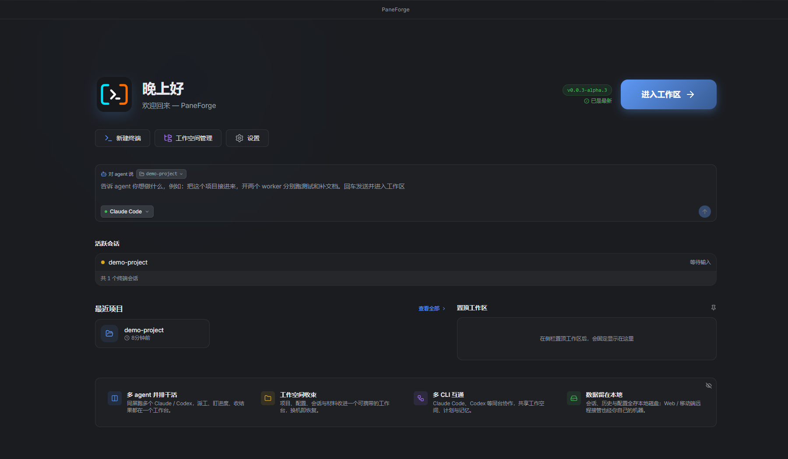
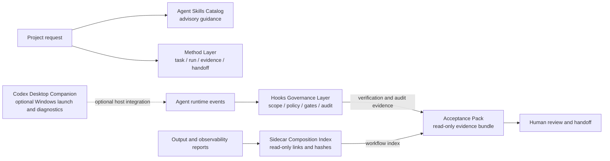
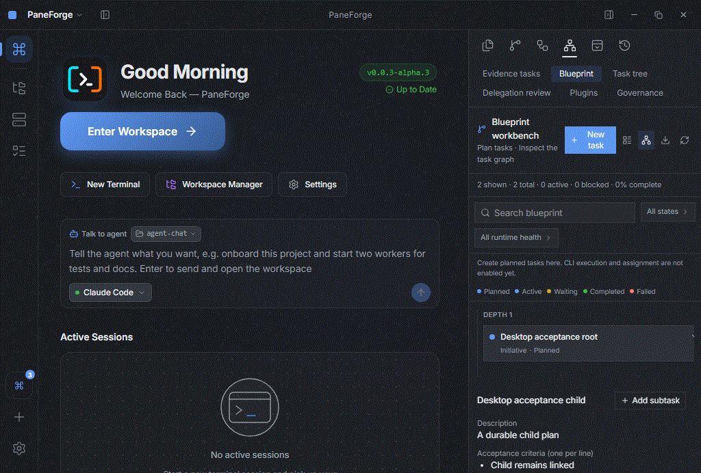
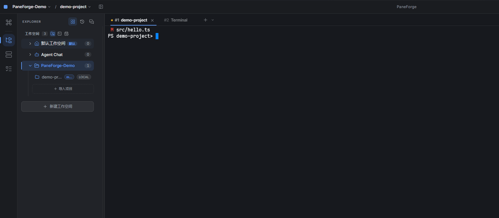
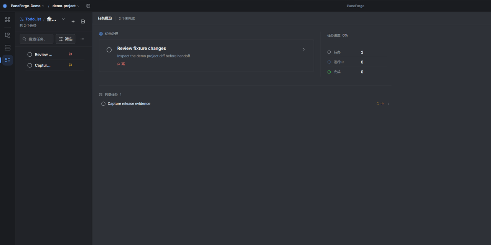
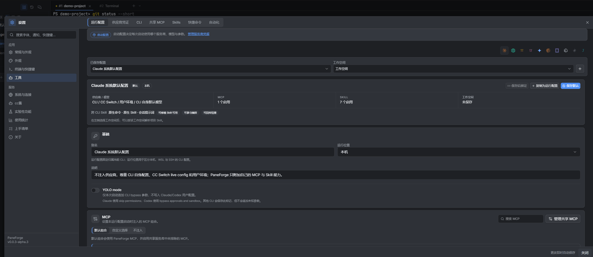
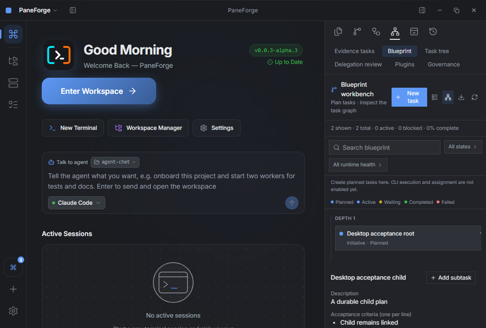
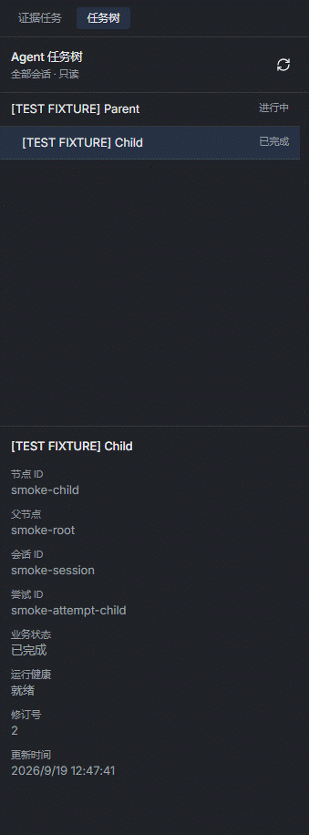
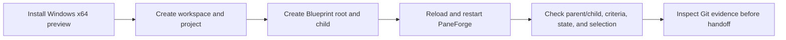
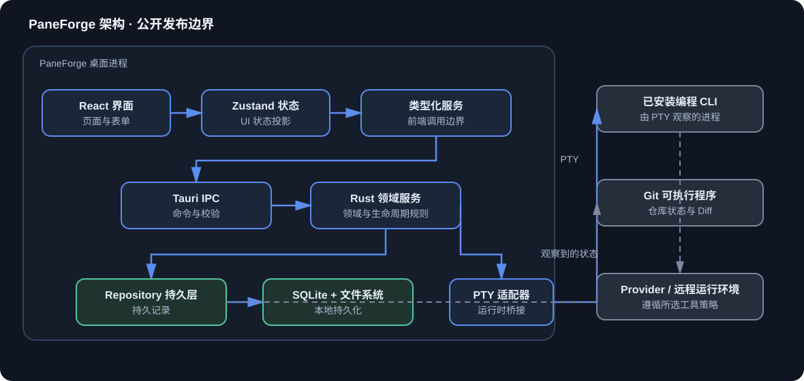

# PaneForge

## A Windows workbench for keeping AI-assisted engineering work reviewable

PaneForge gives a developer one place to organize repositories, run several locally installed coding CLIs, plan work, inspect changes, and keep the evidence needed for a handoff. It is designed for the moment when a terminal transcript is no longer enough to answer **which project changed, what was intended, what actually ran, and what still needs review**.

In this page, an **AI coding CLI** means a coding assistant launched from a terminal. PaneForge organizes those tools and their project context; it does not provide a model account or replace the selected provider.

[](https://github.com/lihuabin1516-design/PaneForge-Releases/releases/latest)
[](#download-and-first-run)
[](LICENSE)
[](https://github.com/lihuabin1516-design/PaneForge-Releases/actions/workflows/windows-source-build.yml)

**Current release:** `0.0.3-alpha.3` preview · **native acceptance:** Windows x64 · **published:** 2026-10-27

[Download the Windows installer](https://github.com/lihuabin1516-design/PaneForge-Releases/releases/download/v0.0.3-alpha.3/PaneForge_0.0.3-alpha.3_x64-setup.exe) · [Open the versioned release](https://github.com/lihuabin1516-design/PaneForge-Releases/releases/tag/v0.0.3-alpha.3) · [Read the release evidence](docs/engineering/portfolio-evidence.md) · [Verify SHA-256](https://github.com/lihuabin1516-design/PaneForge-Releases/releases/download/v0.0.3-alpha.3/SHA256SUMS.txt)



This screenshot comes from a locally built, isolated PaneForge 0.0.3-alpha.3 demo instance; it is not acceptance evidence for the corresponding release. The project and tasks are synthetic fixtures. Its PowerShell terminal is waiting for input and does not show an Agent performing work.

## PaneForge in 60 seconds

| For | The problem | What PaneForge gives back | Evidence in this repository |
| --- | --- | --- | --- |
| Recruiter or product reader | AI coding work is scattered across terminals and folders. | A visible Windows workbench for projects, sessions, plans, and review material. | [Product capability map](docs/product-capabilities.md) |
| Developer | Several repositories and CLI sessions are easy to mix up. | Workspace/project context, tabs, split terminals, launch history, Git and file tools. | [Published capability list](docs/product-capabilities.md#desktop-workbench-included-in-alpha3) |
| Reviewer | A successful-looking transcript does not prove the code is correct. | Explicit task criteria, repository changes, artifacts, checks, and review boundaries. | [Verification contract](docs/engineering/verification.md) |
| Technical interviewer | Product claims are difficult to connect to implementation. | A small, browseable source slice, architecture diagrams, tests, release hashes, and native evidence. | [Portfolio evidence](docs/engineering/portfolio-evidence.md) |

### What is proven in this preview?

- **Native verified:** Blueprint root/child task creation, criteria, reload and full application restart persistence, idempotent retry/conflict handling, parent revision checks, and the Windows release path.
- **Present in the released product source:** multi-session PTY terminals, workspaces and projects, installed CLI adapters, local/WSL/SSH routes where configured, Git and file review tools, MCP/Skill configuration surfaces, local history, session history, and Control Plane records.
- **Still in development:** launch preview with stale-configuration reporting, frozen role/team templates, a named human inbox, and a consolidated delivery view. These are deliberately not described as shipped features.

This distinction is the core of the public page: a design note, a source capability, and a native acceptance result are different kinds of evidence.

## Why the product exists

AI-assisted development becomes difficult to supervise when every session is just another terminal window. PaneForge addresses five concrete moments in that workflow:

1. **Context is fragmented.** A workspace groups repositories, project defaults, layouts, launch history, and session identity so the operator can see what belongs together.
2. **Intent is lost in chat.** Blueprint stores a task description and acceptance criteria before a CLI session exists; a plan remains visibly planned and unassigned until something actually binds to it.
3. **A transcript is not a code review.** Git status, diffs, worktrees, files, editor views, and local snapshots remain available beside the terminal.
4. **Restart should be observable.** Workspace records, task records, process/session records, and runtime observations have separate owners; a restart does not silently become a completion claim.
5. **Permission is not execution.** Task, intervention, recovery, delegation, and plugin records carry explicit scope and evidence labels so an approval is not mistaken for an operating-system side effect.

See the [capability boundary](docs/product-capabilities.md) for the complete public-preview list and its limits.

## The development workflow around PaneForge

PaneForge is the desktop workbench. The repositories below are independently maintained workflow tools and references; they are not all bundled into, or required by, the `0.0.3-alpha.3` installer. The diagram describes evidence and responsibility boundaries, not an automatic six-repository runner.



| Repository | Role in the workflow | Current access and license |
| --- | --- | --- |
| [Agent Skills Catalog](https://github.com/lihuabin1516-design/agnetskills) | Advisory prompts, skills, templates, adoption records, and evaluation examples. It does not grant permissions or decide completion. | Private; license and source review pending. |
| [Method Layer](https://github.com/lihuabin1516-design/method-layer) | Versioned task, run, evidence, and handoff artifacts for reviewable work. | Public; no license is declared, so redistribution rights are not granted. |
| [Hooks Governance Layer](https://github.com/lihuabin1516-design/hooks) | Task scope, project policy, hook gates, audit records, and acceptance evidence. | Public; MIT. |
| [Codex Desktop Companion](https://github.com/lihuabin1516-design/codex-desktop-companion) | Windows launch and diagnostic companion with an optional coordination-plane path. Its README explicitly distinguishes implemented launcher capabilities from unfinished external acceptance and dispatch work. | Private; MIT. |
| [Sidecar Composition Index](https://github.com/lihuabin1516-design/Sidecar-composition-index) | Read-only composition of existing output, observability, and experience artifacts into a hash-checked workflow index. | Private; license and source review pending. |
| [Acceptance Pack](https://github.com/lihuabin1516-design/acceptance-pack) | Read-only packaging of existing workflow and verification evidence for human handoff; it is not the authority that decides completion. | Private; license and source review pending. |

This access snapshot is dated 2026-10-30. Links to private repositories require access, and public visibility alone does not provide an open-source license. The exact source, attribution, and license review must be completed before any further repository is opened.

## A five-minute product tour

### 1. Organize a project

Create or import a workspace, add a repository, and choose the project context used by launches. The release and development profiles use separate data directories, so experiments do not silently reuse release data.

### 2. Open the work surface

Open one or more locally installed coding CLIs in tabs or resizable splits. The terminal is a real PTY execution surface rendered with xterm.js; it is not a success detector.

### 3. Write the plan first

Open **Agent Control Plane → Blueprint → New task**, enter a description and one acceptance criterion per line, save the root, and add a child. The published alpha.3 path stops here: it persists the plan and does not dispatch a worker automatically.



### 4. Inspect the work independently

After a CLI run, inspect Git status and diffs, changed files, local history, and relevant artifacts. A stopped process or a green-looking transcript still requires review.

### 5. Hand off with the right evidence

Use the task criteria, repository evidence, test output, and release metadata to decide whether to accept, revise, or hand off. The current public release makes this review boundary explicit; the consolidated delivery view is still in development.

## Interface evidence

The public visual set distinguishes isolated local demos, versioned native acceptance evidence, and historical feature material.

### Workspace, terminal, and Git review



This two-frame tour shows the workspace project tree, then Git status and a diff in a local PowerShell terminal. The change to `src/hello.ts` was prepared in the synthetic demo repository before capture; the GIF runs only read-only status and diff checks scoped to that file. It demonstrates PaneForge's terminal and review surfaces, not an Agent-authored change or a passing acceptance result.

### TodoList task management



The animation opens a synthetic task from the list and shows its status, priority, workspace scope, description, and activity record. The title and content do not come from a real project or user workspace.

### Run configuration and appearance



This tour shows the run-profile summary and theme selector. CLI, MCP, and Skill information in the settings surface proves only that configuration controls exist; it does not mean this capture invoked an external tool, model provider, or remote runtime. No credential values are shown.

### Native Blueprint evidence



The native frame shows the workspace entry, project/terminal entry points, Agent entry, and the persisted Blueprint tree. [The reopened frame](docs/media/blueprint-alpha3-reopened.png) is a separate acceptance snapshot after application restart. Image provenance, hashes, and fixture boundaries are recorded in [media provenance](docs/media/README.md).

### Control Plane evidence



This three-frame tour is assembled from historical read-only Windows panel captures with synthetic fixture rows. It explains task scope, intervention/recovery scope, and global governance scope; it is not a live trace and is not presented as a screenshot of the current installer. Open the [task tree](docs/media/control-plane-task-tree-dev.png), [history](docs/media/control-plane-history-dev.png), or [governance](docs/media/control-plane-governance-dev.png) panel for the original crops.

The public material still lacks sanitized native captures of a real Agent/CLI conversation, the code editor, session recovery, and remote runtime. This update adds local terminal, task-list, and configuration views without presenting them as Agent execution evidence.

## Reproduce the verified path



Expected result for alpha.3: the parent/child relationship, selected task, description, criteria, `planned` state, and unassigned session remain after renderer reload and full application restart. Task creation does not claim that a CLI ran or that acceptance passed.

## Engineering story for a technical interview

The sections below are deliberately framed as engineering problems, decisions, and verification paths rather than as a technology-name list.

| Engineering problem | Design choice | Where to inspect | What is verified / current limit |
| --- | --- | --- | --- |
| A retry must not create two plans | Request UUID is retained through React; the service bounds input; the repository uses an immediate SQLite transaction. Same content is idempotent; different content conflicts. | [Task model](showcase/source/v0.0.3-alpha.3/paneforge-core/src/models/task_tree.rs), [repository](showcase/source/v0.0.3-alpha.3/paneforge-core/src/repository/task_tree_repository.rs), [tests](showcase/source/v0.0.3-alpha.3/paneforge-core/src/services/blueprint_task_creation_tests.rs) | 36 focused frontend tests and 8 core persistence tests; native restart path passed. |
| Parent and child writes can race | Child creation rechecks parent revision and open state inside the transaction; runtime projection cannot overwrite a manual plan. | [Creation sequence](docs/architecture/product-map.md#2-blueprint-task-creation-sequence) | Covered by focused persistence tests; dispatch is not part of alpha.3. |
| UI state must not impersonate runtime truth | React/Zustand is a projection; typed services cross Tauri IPC; Rust services and repositories own durable records; PTY observations own process facts. | [Architecture source](docs/assets/paneforge-architecture.mmd), [system overview](docs/architecture/system-overview.md) | Boundary is source-backed; optional CLI/provider availability remains host-specific. |
| Approval must not become ambient plugin power | Requests carry manifest revision, grants, resource, channel, and reason. Empty allowlists deny; the result is a typed authorization receipt. | [Capability model](showcase/source/v0.0.3-alpha.3/paneforge-core/src/models/plugin_host.rs), [broker](showcase/source/v0.0.3-alpha.3/paneforge-core/src/services/plugin_host_adapter.rs) | 14 focused host-adapter tests; this is a policy contract, not OS-level sandboxing. |
| A binary must be traceable to inspectable source | Release metadata binds version, source commit, source ZIP hash, installer hash, lockfiles/toolchain inputs, updater signature, and native acceptance run. | [Release case study](docs/engineering/portfolio-evidence.md#case-study-d-traceable-windows-distribution) | `0.0.3-alpha.3` source build and Windows acceptance are recorded; the showcase is a navigation aid, not the complete source archive. |

### Suggested interview route

1. Start with [the Blueprint form](showcase/source/v0.0.3-alpha.3/web/components/controlplane/BlueprintTaskForm.tsx) and follow the request into the service and repository.
2. Ask why a planned task is intentionally unassigned, then compare the model with the native acceptance GIF.
3. Inspect the broker receipt and discuss why an allowlist is not the same as sandboxing.
4. Open the architecture source and trace the frontend → typed service → Tauri IPC → Rust service → repository boundary.
5. Finish with the release evidence table and verify the published installer/source hashes.

## Architecture



The editable source is [paneforge-architecture.mmd](docs/assets/paneforge-architecture.mmd). It shows verified call and authority boundaries; it is not a runtime recording and does not imply that every optional CLI or provider is installed on every machine.

## My contribution

The public evidence supports the following PaneForge product work:

| Area | Contribution visible in the product | Evidence boundary |
| --- | --- | --- |
| Productization | Product identity, Windows bundle identity, `%USERPROFILE%\.paneforge` routing, update channel, bilingual release page, and public/private distribution split. | Release workflows and identity checks are public; a line-by-line author ledger is intentionally not part of this release repository. |
| Planning and review | Blueprint root/child tasks, criteria, bounded input, idempotent retry, parent revision checks, persistence, and restart selection. | Browseable source plus native acceptance run. |
| Control Plane | Scoped task, intervention/recovery, delegation, and plugin records with explicit evidence boundaries. | Historical UI fixtures and the scoped projection case study. |
| Capability policy | Revision-bound grants, resource allowlists, default-deny behavior, and typed receipts. | Public source slice and acceptance record; alpha.3 does not expose arbitrary plugin side effects. |
| Release engineering | Corresponding-source packaging, SHA-256 mapping, Windows source-build workflow, isolated installation, and native smoke evidence. | Published assets and GitHub Actions records. |

This is a claim about product work that can be traced in the public material. GPL notices and retained copyright statements remain in the distribution; no claim is made that every line of every dependency was written from scratch. See [the modification record](docs/compliance/source-attribution.md), [NOTICE](NOTICE.md), and [LICENSE](LICENSE).

## Download and first run

### Download the exact release assets

- [Windows x64 installer](https://github.com/lihuabin1516-design/PaneForge-Releases/releases/download/v0.0.3-alpha.3/PaneForge_0.0.3-alpha.3_x64-setup.exe)
- [Versioned release page](https://github.com/lihuabin1516-design/PaneForge-Releases/releases/tag/v0.0.3-alpha.3)
- [Updater manifest](https://github.com/lihuabin1516-design/PaneForge-Releases/releases/download/v0.0.3-alpha.3/latest.json)
- [Installer signature](https://github.com/lihuabin1516-design/PaneForge-Releases/releases/download/v0.0.3-alpha.3/PaneForge_0.0.3-alpha.3_x64-setup.exe.sig)
- [SHA-256 file](https://github.com/lihuabin1516-design/PaneForge-Releases/releases/download/v0.0.3-alpha.3/SHA256SUMS.txt)
- [Matching GPL source ZIP](https://github.com/lihuabin1516-design/PaneForge-Releases/releases/download/v0.0.3-alpha.3/PaneForge_0.0.3-alpha.3_source.zip)

| Asset | SHA-256 |
| --- | --- |
| Installer | `842b8c2a7714a18f24200185bf163079b6de908697f53d2b739233f52a464d6b` |
| Source ZIP | `4feb8686e8165f3b7a1d3ae3cd2fd8ee3404420eeb14cce275f40005a42a1c85` |

```powershell
Get-FileHash .\PaneForge_0.0.3-alpha.3_x64-setup.exe -Algorithm SHA256
Get-FileHash .\PaneForge_0.0.3-alpha.3_source.zip -Algorithm SHA256
```

### Run the smallest verifiable scenario

1. Install the Windows x64 package. Windows may warn because the installer is not Authenticode-signed; the updater signature is a separate release-integrity mechanism.
2. Start PaneForge and choose **Enter Workspace** or **Workspace Manager**.
3. Open **Agent Control Plane → Blueprint → New task**.
4. Add a child task, refresh the renderer, and restart the application.
5. Confirm the parent/child relationship, selected details, `planned` state, and unassigned session remain.

Release data is stored under `%USERPROFILE%\.paneforge`; development builds use `%USERPROFILE%\.paneforge-dev`. Save active sessions before updating because installation can restart the desktop process. The public verification scope is Windows x64; other platforms and CLI-specific behavior are outside this release promise.

## Release, tests, and status

### Completed and verified for `0.0.3-alpha.3`

- Blueprint root/subtask creation with descriptions and acceptance criteria.
- Persistence through renderer reload and full application restart.
- Idempotent retry and conflict handling for task creation.
- Parent revision/open-state checks and protection against runtime projection overwrites.
- Default-deny capability-broker contract and scoped Control Plane projections.
- Windows x64 source build, installer creation, isolated install, and native Blueprint smoke.

Evidence includes [36 focused frontend tests and 8 core persistence tests](docs/engineering/portfolio-evidence.md#verification), a 1772-test core suite in the source-build run, and the follow-up native acceptance run. Historical Control Plane test counts are labelled historical and were not rerun for this documentation change.

### Development or pending

- Launch preview with stale-configuration reporting.
- Frozen role/team templates.
- Named human handoff inbox.
- Consolidated delivery view with Git, artifacts, and actual acceptance evidence.
- Sanitized public screenshots of an active CLI, Git diff, editor, session recovery, and remote runtime.
- A public commit/author ledger for the exact personal contribution split.

These items become preview claims only after they enter a versioned installer with matching source and Windows evidence.

## Source, license, and public boundary

PaneForge is distributed under GPL-3.0. Each release includes corresponding source, retained license/copyright notices, modification information, and `SHA256SUMS.txt`. The `showcase/` directory contains selected files copied from the exact release source snapshot so a reviewer can start reading quickly; it is not a second build tree. The complete corresponding source archive is the legal and technical record for the binary.

This public repository contains release artifacts, verification workflows, source navigation, and reviewer-facing documentation. User workspaces, credentials, session transcripts, signing keys, private history, and unreviewed diagnostics remain outside the public distribution.

## Further reading

- [Interview brief (中文)](docs/interview-brief.zh-CN.md)
- [Product capabilities and workflow](docs/product-capabilities.md)
- [Architecture maps and task lifecycle](docs/architecture/product-map.md)
- [Runtime and capability boundaries](docs/architecture/runtime-boundaries.md)
- [Implementation and acceptance evidence](docs/engineering/portfolio-evidence.md)
- [Verification contract](docs/engineering/verification.md)
- [Public release process](docs/engineering/release-process.md)
- [Browseable source showcase](showcase/README.md)
- [中文 README](README.zh-CN.md)

## Feedback

Use [GitHub Issues](https://github.com/lihuabin1516-design/PaneForge-Releases/issues) for reproducible release problems. Do not attach API keys, private workspaces, session transcripts, or signing material. See [SECURITY.md](SECURITY.md) for security reports.
