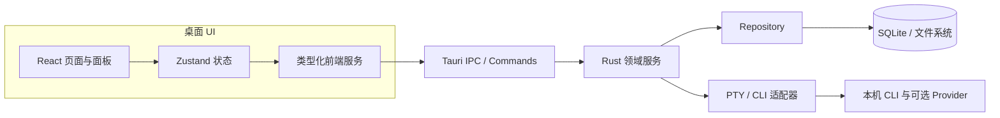

# PaneForge 公开版

PaneForge 是面向并行 AI 工程的本地优先桌面控制平面。它把多个 CLI Agent、PTY 终端、工作空间、项目、蓝图任务、Git、MCP、Skill、文件历史和验收证据放进一个可恢复、可审查的工作流。应用元数据保存在本地；Agent CLI 和用户配置的 Provider 可能会按照各自策略传输提示词、项目内容或遥测数据，PaneForge 不承诺对话内容永不离开设备。

本仓库是 PaneForge 的公开分发仓库和求职展示入口，不是完整开发仓库镜像。这里发布安装包、更新清单、校验值、对应版本源码 ZIP、公开验收工作流和产品文档；完整开发历史、未发布功能、内部任务文件和用户数据继续保留在私有仓库。


*动图由同一次隔离 Windows 原生验收中的两个独立截图组成：创建主/子任务后，以及应用重启后。它不是连续录屏。可查看[创建后截图](docs/media/blueprint-alpha3-created.png)、[重启后截图](docs/media/blueprint-alpha3-reopened.png)及[原生验收运行](https://github.com/lihuabin1516-design/PaneForge-Releases/actions/runs/40461026994)。*

## 功能和公开状态

| 模块 | 公开版状态 | 说明 |
| --- | --- | --- |
| 工作空间/项目管理 | Preview | 按工作空间组织多个项目，保存运行环境、Provider、布局和任务上下文。 |
| 多 CLI 分屏终端 | Preview | 通过 PTY 和 xterm.js 同时运行多个 CLI 会话，支持标签与分屏。 |
| 启动上下文 | Preview | 记录项目路径、运行时、Provider、Skill、MCP 和会话身份。 |
| 蓝图任务 | Preview | 创建主任务和子任务，保存任务说明与逐条验收标准；创建任务不会自动启动 CLI。 |
| Git/Worktree | Preview | 在终端旁查看分支状态并执行常用仓库操作。 |
| 文件历史和编辑器 | Preview | 提供本地文件历史、Diff、文件浏览和内置编辑器。 |
| MCP/Skill 配置 | Preview | 在工作空间和项目边界内显示工具与技能选择。 |
| 更新与来源验证 | Preview | 发布 Windows x64 安装包、签名更新清单、校验值、对应源码和自动化验证证据。 |
| 蓝图启动预览、团队冻结、人工收件箱、交付视图 | Development | 已在私有开发线推进，尚未承诺包含在当前公开安装包中。 |

`Preview` 表示当前公开抢先版包含或验证过的能力；`Development` 表示私有开发线已设计或实现，但不能从公开安装包推断其已经发布。完整边界见 [公开范围说明](docs/engineering/public-scope.md)。

## 下载与更新

- [PaneForge Releases](https://github.com/lihuabin1516-design/PaneForge-Releases/releases)
- [当前 Windows x64 抢先版](https://github.com/lihuabin1516-design/PaneForge-Releases/releases/tag/v0.0.3-alpha.3)
- [English README](README.md)
- [产品能力与工作流](docs/product-capabilities.md)

首次使用请安装当前 Release 中的 Windows x64 安装包。后续抢先版可以在 **设置 -> 关于 -> 检查更新** 中发现。安装更新可能重启桌面进程，请先保存正在运行的会话。

发布版数据目录为：

```text
%USERPROFILE%\.paneforge
```

开发版使用独立目录 `%USERPROFILE%\.paneforge-dev`，不会静默接管发布版数据。当前公开更新通道只承诺 Windows x64。

## 技术架构



PaneForge 将 CLI 进程视为可观察运行时，而不是数据库本身。系统分别记录启动意图、会话身份、任务绑定、输出证据和恢复状态，因此进程中断时不会被错误地标记为“任务已完成”。

当前 alpha.3 蓝图保存的是 `planned`、未分配任务；创建操作不会直接派发 CLI。架构图、任务创建时序图、任务数据边界及公私仓库发布链路见[架构与流程图](docs/architecture/product-map.md)。

## 工程问题与可核验成果

| 工程问题 | 设计与实现 | 可核验证据 |
| --- | --- | --- |
| 创建任务时遇到超时重试，如何避免重复计划？ | UUID 幂等请求、SQLite immediate transaction；同 UUID 不同内容返回冲突。 | [任务模型、Repository、服务与测试源码](showcase/README.md) |
| 子任务创建期间父任务状态可能变化，怎么办？ | 在事务中复核父节点 revision 和开放状态，并拒绝过期父节点。 | [任务创建时序图](docs/architecture/product-map.md) |
| UI reload 或应用重启后计划是否还存在？ | 计划写入本地持久层；原生验收覆盖刷新、renderer reload 和应用重启。 | [验收截图、运行记录和测试数据](docs/engineering/portfolio-evidence.md) |
| 插件审批是否意味着宿主操作权限？ | 不意味着。Broker 每次检查版本绑定的授权与资源 allowlist；空列表默认拒绝，alpha.3 不开放实际宿主副作用。 | [Broker 实现和验收记录](showcase/README.md) |
| 安装包如何对应到可检查的源码？ | 固定源码提交、源码 ZIP SHA-256、安装包 SHA-256、发布工作流和隔离 Windows 原生验收分别留证。 | [alpha.3 发布证据](docs/engineering/portfolio-evidence.md) |

蓝图实现的主要 Rust/React 文件、测试以及精确源码身份见[源码浏览目录](showcase/README.md)。本仓库中的样例逐字节对应已发布标签；它们便于代码导航，不替代 Release 中完整、可构建的 GPL 对应源码 ZIP。

详细文档：

- [产品能力与工作流](docs/product-capabilities.md)
- [实现案例与验收证据](docs/engineering/portfolio-evidence.md)
- [源码浏览目录](showcase/README.md)
- [架构、权责边界与 Mermaid 流程图](docs/architecture/product-map.md)
- [系统概览](docs/architecture/system-overview.md)
- [控制平面生命周期](docs/architecture/control-plane.md)
- [运行时和能力边界](docs/architecture/runtime-boundaries.md)
- [验证与证据](docs/engineering/verification.md)
- [发布流程](docs/engineering/release-process.md)

## 阴阳仓库边界

PaneForge 采用两个职责不同的仓库：

1. 阴仓库（私有产品仓库）：完整源码、Git 历史、未发布功能、内部工作流和私有验收材料。
2. 阳仓库（本仓库）：安装包、对应源码获取入口、公开验证工作流、用户文档和求职展示材料。

以下内容不得进入阳仓库：用户工作空间、Provider 密钥、会话全文、内部任务账本、签名密钥、私有 Git 历史和未审查的诊断转储。每次发布前都要做公开范围审查。

## 对应源码和合规

PaneForge 使用 GPL-3.0 发布。每个二进制 Release 都提供同版本的 `PaneForge_<版本>_source.zip`、`SHA256SUMS.txt` 和来源元数据。源码 ZIP 不包含私有 Git 历史或用户数据。

PaneForge 的产品命名、运行时命名空间、数据目录、控制平面增量、公开文档和验收材料由 PaneForge 独立维护。项目中仍包含经过修改的 GPL 基础代码，因此必要的来源、修改范围和许可证义务集中记录在 [上游来源说明](docs/compliance/upstream-provenance.md)；第三方组件说明见 [NOTICE.md](NOTICE.md) 和 [第三方声明](docs/compliance/third-party-notices.md)。

## 反馈

公开版问题请使用 [GitHub Issues](https://github.com/lihuabin1516-design/PaneForge-Releases/issues)，提交时请说明版本、Windows 版本、复现步骤和相关日志。不要上传 API 密钥、私有工作空间、会话全文或签名材料。安全问题请先阅读 [SECURITY.md](SECURITY.md)。
