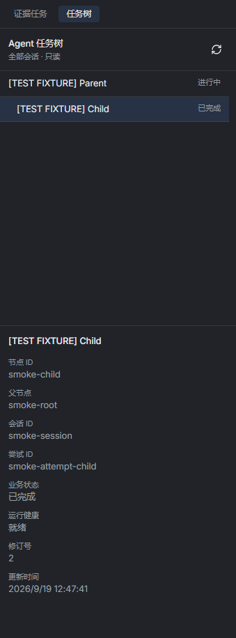
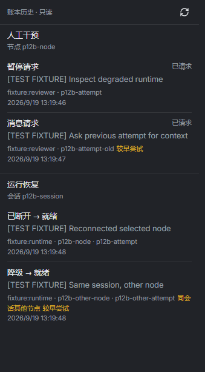
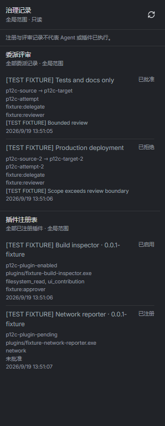
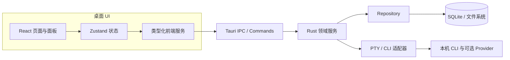

# PaneForge 公开版

PaneForge 是面向 AI 辅助软件开发的本地优先桌面工作台，供需要同时使用多个编程 CLI、终端和代码仓库的开发者管理并行工作。它整合工作空间、项目、Agent 工作流、Git、文件编辑、会话恢复和交付检查；在此桌面工作台基础上，PaneForge 增加蓝图规划与 Agent 控制平面。PaneForge 基于经过修改的 GPL-3.0 CC-Panes 工作空间基础构建，并作为独立产品维护。应用元数据保存在本地；Agent CLI 和用户配置的 Provider 可能会按照各自策略传输提示词、项目内容或遥测数据，PaneForge 不承诺对话内容永不离开设备。

本仓库是 PaneForge 的公开分发仓库和求职展示入口，不是完整开发仓库镜像。这里发布安装包、更新清单、校验值、对应版本源码 ZIP、公开验收工作流和产品文档；完整开发历史、未发布功能、内部任务文件和用户数据继续保留在私有仓库。


*动图由同一次隔离 Windows 原生验收中的两个独立截图组成：创建主/子任务后，以及应用重启后。它不是连续录屏。可查看[创建后截图](docs/media/blueprint-alpha3-created.png)、[重启后截图](docs/media/blueprint-alpha3-reopened.png)及[原生验收运行](https://github.com/lihuabin1516-design/PaneForge-Releases/actions/runs/40461026994)。*

第一帧显示已保存的主任务和子任务，以及子任务说明和验收标准；第二帧来自应用重启后的另一张截图，展示两个节点仍在、父子关系保留且子任务详情仍被选中。创建操作只写入持久化的 `planned` 计划，不会派发 CLI，也不代表任务完成。

## 从零认识 PaneForge

如果第一次接触 PaneForge，可以把它理解为“管理多个 AI 编程 CLI 的桌面工作台”：开发者先把代码仓库加入工作空间，选择本机已安装的 CLI 和运行环境，在分屏终端中并行工作，再用 Git、文件编辑器、本地历史和任务验收信息检查结果。PaneForge 不提供模型账号，也不把聊天输出本身当作代码已验收的证明。

## 功能和公开状态

| 模块 | 公开版状态 | 说明 |
| --- | --- | --- |
| 模块 | 公开版状态 | 能力与开发价值 |
| --- | --- | --- |
| 工作空间与项目 | Preview | 工作台概览活跃会话、近期项目、可用 CLI 和使用情况；同时组织仓库、项目配置、布局及项目顺序。 |
| 分屏终端与布局 | Preview | 以 PTY 和 xterm.js 运行真实终端；支持多标签、可调整分屏、保存布局、滚屏和终端恢复。 |
| 多 CLI Agent | Preview，依赖用户本机安装 | 包含 Claude Code、Codex CLI、Gemini CLI、Kimi、Grok、OpenCode、Cursor 启动适配；适配器注册表还包含 Pi、OMP、JCode。其他终端命令也可在 PTY 中运行，集成深度因 CLI 而异。 |
| 本地/WSL/SSH 运行环境 | Preview，依赖环境配置 | 为项目选择本机、WSL 或 SSH 路径，在对应运行环境中启动 CLI 和执行开发工作。 |
| Agent 工作流 | Preview | 提供 Agent Chat、MCP 主控/Worker 编排、Plans、Specs、Todos、Journal、会话摘要和 Memory。 |
| 启动配置与共享工具 | Preview | 复用 Provider/模型、运行时、权限、Hooks、Skill 和 MCP 配置；按适用范围配置项目及共享 MCP/Skill。 |
| Git 与 Worktree | Preview | 查看仓库状态，执行常见 pull/push/fetch/stash、分支、克隆和 Worktree 操作，并检查提交图、Diff、解决冲突。 |
| 文件浏览与代码编辑 | Preview | 浏览、搜索、创建、重命名、复制、移动和删除项目文件；使用 Monaco 编辑器及 Markdown/图片预览。 |
| 会话历史与恢复 | Preview，依赖 CLI 支持 | 查看启动历史和会话身份，恢复 CLI 支持的会话，并清理失效会话记录；不同 CLI 的恢复能力有差异。 |
| 本地文件历史与截图 | Preview | 创建带标签的本地文件版本快照、对比历史 Diff，并用可配置快捷键进行多显示器截图。 |
| 桌面控制与外观 | Preview | 包含命令面板、系统托盘、快捷终端、资源监控、主题、壁纸及终端/背景外观设置。 |
| 蓝图任务规划 | Preview | 新建主任务和子任务，保存说明与逐条验收标准；任务创建不会直接派发 CLI。 |
| PaneForge Agent 控制平面 | Preview | 展示任务树、人工干预/运行恢复历史、委派审查与插件治理记录；记录不证明真实进程执行。 |
| 插件能力治理 | Preview | 基于 revision 校验和默认拒绝的能力 Broker 管理授权；alpha.3 不开放任意插件宿主副作用。 |
| 更新与来源验证 | Preview | 发布 Windows x64 抢先版、签名更新清单、校验值、同版本 GPL 源码和自动化验收证据。 |
| 蓝图执行与交付流程 | Development | 启动预览、冻结团队模板、定向人工交接和集中交付证据尚未包含在当前公开安装包。 |

`Preview` 表示当前公开抢先版包含或有对应源码/验收证据的能力；`Development` 表示私有开发线已设计或实现，但不能从公开安装包推断其已经发布。不同 CLI 的 Hooks、MCP、会话恢复和远程环境支持程度并不完全相同。PaneForge 从 CC-Panes `0.12.20` 基础开始，并选择性吸收 `0.12.21` 的变更；这不代表与上游该版本完全功能一致。具体来源和边界见 [上游来源说明](docs/compliance/upstream-provenance.md) 与 [公开范围说明](docs/engineering/public-scope.md)。

## 控制平面图集

以下是 2026-09-19 隔离 Windows 验收期间生成的三张只读控制平面视图，图中记录均为 `[TEST FIXTURE]` 合成测试数据。配套的 P1.2c UI 验收快照记录测试应用为 `PaneForge DEV v0.0.1`；三张 PNG 本身都只截取面板，不包含应用标题栏或版本标识。它们都不是当前 `0.0.3-alpha.3` 安装包的截图。当前公开版验收画面请看本文开头的蓝图持久化序列。

### 任务树与运行时身份

上半部分显示一个“进行中”的父任务及其缩进子任务，子任务状态为“已完成”。下半部分是所选子任务详情：节点 `smoke-child`、父节点 `smoke-root`、会话 `smoke-session` 和尝试 `smoke-attempt-child` 分开列出，同时显示业务状态、运行健康、修订号和更新时间。这样可以核对树关系、选中详情及运行字段是否分别呈现，而不是把任务标题或终端文字当成全部任务记录。

<a href="docs/media/control-plane-task-tree-dev.png"></a>

行和标识都是测试 fixture。图片证明的是界面如何投影保存的任务/运行字段，不证明曾经启动真实 CLI、Agent 确实完成了任务，也不是当前 alpha.3 安装包画面。详见[任务树与运行时身份说明](docs/product-capabilities.md#task-tree-and-runtime-identity)，或[打开原尺寸图片](docs/media/control-plane-task-tree-dev.png)。

### 人工干预与运行恢复历史

这个视图刻意分开两个作用范围：人工干预账本属于节点 `p12b-node`，列出暂停请求和消息请求，并标出当前及较早的尝试；运行恢复账本属于会话 `p12b-session`，显示所选节点从“已断开”恢复到“就绪”，以及同一会话另一个节点从“降级”恢复到“就绪”。操作者、原因、时间、节点和尝试标记帮助审阅者判断每条记录归属哪个范围和尝试。

<a href="docs/media/control-plane-history-dev.png"></a>

这些是合成账本行，不是聊天内容，也不证明人工干预或运行恢复动作真的执行过；该界面为只读。详见[人工干预与运行恢复历史说明](docs/product-capabilities.md#intervention-and-recovery-history)，或[打开原尺寸图片](docs/media/control-plane-history-dev.png)。

### 全局委派与插件记录

左侧“委派评审”标明全局范围，并把决定与理由并列展示：有边界的测试/文档请求获批，生产部署请求被拒绝。右侧“插件注册表”同样标明全局范围，并区分“已启用”的构建检查插件与“已注册”的网络报告插件。顶部提示明确说明：评审和注册记录不代表 Agent 或插件已经执行。

<a href="docs/media/control-plane-governance-dev.png"></a>

名称、操作者、授权和决定均为测试 fixture。这是只读投影；图片不证明发生过委派运行、插件启动或副作用，也不证明存在宿主沙箱。详见[全局治理记录说明](docs/product-capabilities.md#global-governance-records)，或[打开原尺寸图片](docs/media/control-plane-governance-dev.png)。

可核对[控制平面功能说明](docs/product-capabilities.md#agent-control-plane-records)、[工程验收案例](docs/engineering/portfolio-evidence.md#case-study-c-scoped-control-plane-projections)和[图片来源、版本与哈希](docs/media/README.md)。

## 下载与更新

- [PaneForge Releases](https://github.com/lihuabin1516-design/PaneForge-Releases/releases)
- [当前 Windows x64 抢先版](https://github.com/lihuabin1516-design/PaneForge-Releases/releases/tag/v0.0.3-alpha.3)
- [English README](README.md)
- [产品能力与工作流](docs/product-capabilities.md)

首次使用请安装当前 Release 中的 Windows x64 安装包。后续抢先版可以在 **设置 -> 关于 -> 检查更新** 中发现。安装更新可能重启桌面进程，请先保存正在运行的会话。

发布版数据目录为：

```text
%USERPROFILE%\.paneforge
```

开发版使用独立目录 `%USERPROFILE%\.paneforge-dev`，不会静默接管发布版数据。当前公开更新通道只承诺 Windows x64。

## 技术架构



PaneForge 将 CLI 进程视为可观察运行时，而不是数据库本身。系统分别记录启动意图、会话身份、任务绑定、输出证据和恢复状态，因此进程中断时不会被错误地标记为“任务已完成”。

当前 alpha.3 蓝图保存的是 `planned`、未分配任务；创建操作不会直接派发 CLI。架构图、任务创建时序图、任务数据边界及公私仓库发布链路见[架构与流程图](docs/architecture/product-map.md)。

## 工程问题与可核验成果

| 工程问题 | 设计与实现 | 可核验证据 |
| --- | --- | --- |
| 创建任务时遇到超时重试，如何避免重复计划？ | UUID 幂等请求、SQLite immediate transaction；同 UUID 不同内容返回冲突。 | [任务模型、Repository、服务与测试源码](showcase/README.md) |
| 子任务创建期间父任务状态可能变化，怎么办？ | 在事务中复核父节点 revision 和开放状态，并拒绝过期父节点。 | [任务创建时序图](docs/architecture/product-map.md) |
| UI reload 或应用重启后计划是否还存在？ | 计划写入本地持久层；原生验收覆盖刷新、renderer reload 和应用重启。 | [验收截图、运行记录和测试数据](docs/engineering/portfolio-evidence.md) |
| 插件审批是否意味着宿主操作权限？ | 不意味着。Broker 每次检查版本绑定的授权与资源 allowlist；空列表默认拒绝，alpha.3 不开放实际宿主副作用。 | [Broker 实现和验收记录](showcase/README.md) |
| 安装包如何对应到可检查的源码？ | 固定源码提交、源码 ZIP SHA-256、安装包 SHA-256、发布工作流和隔离 Windows 原生验收分别留证。 | [alpha.3 发布证据](docs/engineering/portfolio-evidence.md) |

蓝图实现的主要 Rust/React 文件、测试以及精确源码身份见[源码浏览目录](showcase/README.md)。本仓库中的样例逐字节对应已发布标签；它们便于代码导航，不替代 Release 中完整、可构建的 GPL 对应源码 ZIP。

详细文档：

- [产品能力与工作流](docs/product-capabilities.md)
- [实现案例与验收证据](docs/engineering/portfolio-evidence.md)
- [源码浏览目录](showcase/README.md)
- [架构、权责边界与 Mermaid 流程图](docs/architecture/product-map.md)
- [系统概览](docs/architecture/system-overview.md)
- [控制平面生命周期](docs/architecture/control-plane.md)
- [运行时和能力边界](docs/architecture/runtime-boundaries.md)
- [验证与证据](docs/engineering/verification.md)
- [发布流程](docs/engineering/release-process.md)

## 阴阳仓库边界

PaneForge 采用两个职责不同的仓库：

1. 阴仓库（私有产品仓库）：完整源码、Git 历史、未发布功能、内部工作流和私有验收材料。
2. 阳仓库（本仓库）：安装包、对应源码获取入口、公开验证工作流、用户文档和求职展示材料。

以下内容不得进入阳仓库：用户工作空间、Provider 密钥、会话全文、内部任务账本、签名密钥、私有 Git 历史和未审查的诊断转储。每次发布前都要做公开范围审查。

## 对应源码和合规

PaneForge 使用 GPL-3.0 发布。每个二进制 Release 都提供同版本的 `PaneForge_<版本>_source.zip`、`SHA256SUMS.txt` 和来源元数据。源码 ZIP 不包含私有 Git 历史或用户数据。

PaneForge 的产品命名、运行时命名空间、数据目录、控制平面增量、公开文档和验收材料由 PaneForge 独立维护。项目中仍包含经过修改的 GPL 基础代码，因此必要的来源、修改范围和许可证义务集中记录在 [上游来源说明](docs/compliance/upstream-provenance.md)；第三方组件说明见 [NOTICE.md](NOTICE.md) 和 [第三方声明](docs/compliance/third-party-notices.md)。

## 反馈

公开版问题请使用 [GitHub Issues](https://github.com/lihuabin1516-design/PaneForge-Releases/issues)，提交时请说明版本、Windows 版本、复现步骤和相关日志。不要上传 API 密钥、私有工作空间、会话全文或签名材料。安全问题请先阅读 [SECURITY.md](SECURITY.md)。
