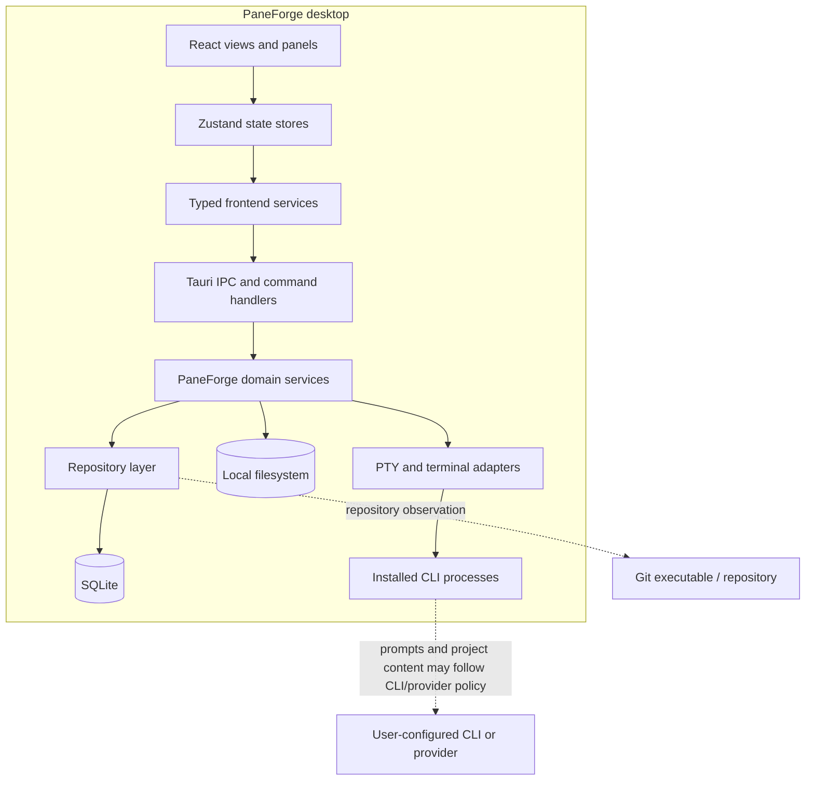
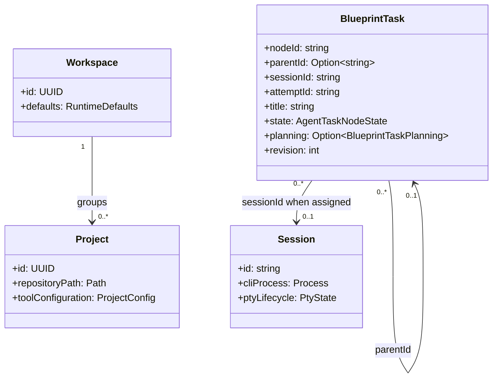
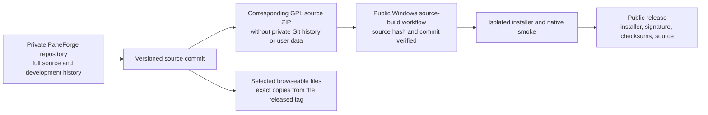

# PaneForge architecture and workflow maps

> These diagrams are derived views for product readers. They do not replace source code, schemas, or acceptance records. The public feature baseline is `0.0.3-alpha.3` unless a box is explicitly marked `Development`.

## 1. Component map

Question: where does a desktop action go, and which layer owns persistence or process observation?



**Authority note:** UI state is a projection. Durable repositories own persisted task records; PTY/process observations own runtime facts. A terminal transcript is not a task acceptance record. The provider edge is optional and depends on the CLI/runtime selected by the user.

Sources: the [system overview](../architecture/system-overview.md) describes the layered invocation path; the alpha.3 task implementation is browsable under [showcase/source](../../showcase/README.md).

## 2. Blueprint task creation sequence

Question: what happens when a user saves a root task or subtask in the alpha.3 Blueprint panel?

```mermaid
sequenceDiagram
  autonumber
  actor User
  participant Form as React task form
  participant Service as Frontend task service
  participant IPC as Tauri command
  participant Core as Task-tree service
  participant Repo as SQLite repository

  User->>Form: Enter title, description and criteria
  Form->>Service: Create with request UUID and optional parent revision
  Service->>IPC: Typed create request
  IPC->>Core: Validate and normalize input
  Core->>Repo: Begin immediate transaction
  Repo->>Repo: Check request UUID for idempotent retry/conflict
  Repo->>Repo: Revalidate parent revision and open state
  Repo->>Repo: Insert planned, unassigned task
  Repo-->>Core: Durable task record
  Core-->>Form: Created task
  Form-->>User: Select task and show its details

  alt same UUID and same content is retried
    Repo-->>Core: Return existing durable record
  else UUID conflicts or parent is stale/closed
    Repo-->>Form: Return explicit conflict; no duplicate child
  end
```

**Boundary:** in `0.0.3-alpha.3`, creation stops at the persisted unassigned plan. There is no arrow from this save operation to CLI launch. The later configure/dispatch flow is tracked as development work, not an alpha.3 behavior.

Sources: [task-tree repository snapshot](../../showcase/source/v0.0.3-alpha.3/paneforge-core/src/repository/task_tree_repository.rs), [task service snapshot](../../showcase/source/v0.0.3-alpha.3/paneforge-core/src/services/task_tree_service.rs), [native acceptance run](https://github.com/lihuabin1516-design/PaneForge-Releases/actions/runs/40461026994).

## 3. Task and runtime data boundary

This model view highlights a version-specific boundary: alpha.3 task rows do not have a workspace or project foreign key. An unassigned planned task stores empty session and attempt identifiers; do not infer a durable project association from which panel was open when it was created.



The diagram is not a database ERD. Workspace and project are product context shown separately; no task-to-workspace or task-to-project relation is implied by this release's task schema. In alpha.3 the root/subtask planning record is durable, but task-to-session dispatch is not part of the create operation. The `Session` box is a runtime concept and its lifecycle is not inferred from task text. See the [released task model](../../showcase/source/v0.0.3-alpha.3/paneforge-core/src/models/task_tree.rs) and [SQLite repository](../../showcase/source/v0.0.3-alpha.3/paneforge-core/src/repository/task_tree_repository.rs).

## 4. Public/private distribution path

Question: how can the public showcase be useful without exposing private development history?



The public code samples are frozen to the released alpha.3 source commit; they do not track unreviewed changes on the private branch. The full corresponding source archive remains the buildable source of truth.

## Diagram receipt

- `derived`: true
- `authoritative`: false
- `audience`: prospective users, hiring managers, and engineers reviewing the public release
- `sensitive data`: none; no real workspace, provider, user session, or credential appears
- `render status`: Mermaid source included for GitHub rendering; visual receipt is the repository's rendered Markdown page
- `canonical evidence`: versioned source archive and linked Windows Actions runs
